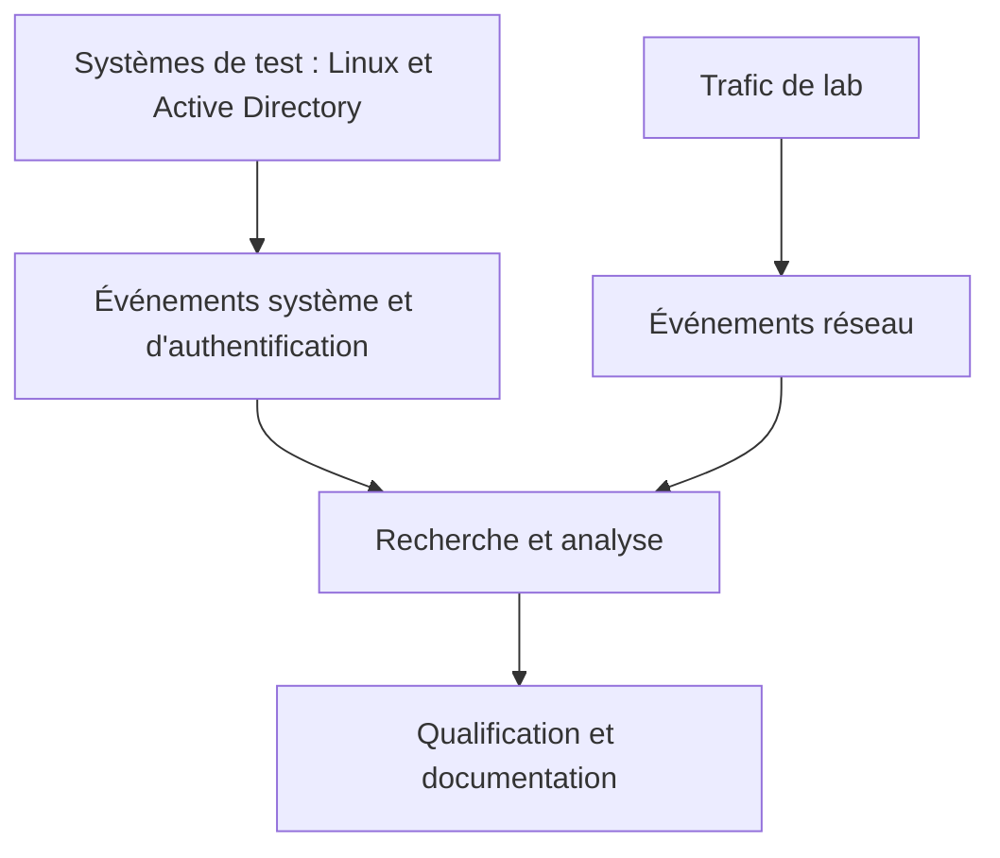

# Architecture fonctionnelle de détection

Cette vue situe les fonctions explorées dans un lab personnel. Elle ne prétend pas que tous les outils sont installés ensemble ni qu'ils sont directement intégrés.

| Fonction | Exemples d'outils expérimentés | Point d'attention |
| --- | --- | --- |
| Scénarios et systèmes | Linux, Active Directory, GOAD | Réserver les machines volontairement vulnérables à un lab isolé. |
| Collecte et visibilité | Wazuh, Security Onion | Vérifier les sources réellement configurées et les données reçues. |
| Détection réseau | Snort | Une absence d'alerte ne démontre pas l'absence d'activité. |
| Recherche et visualisation | Kibana | Adapter la recherche aux champs et aux données effectivement indexés. |

Les fonctions peuvent se recouvrir selon les versions et les installations. Les produits ont leurs propres prérequis ; ce dépôt ne fournit pas de configuration d'intégration ni de procédure d'installation.
